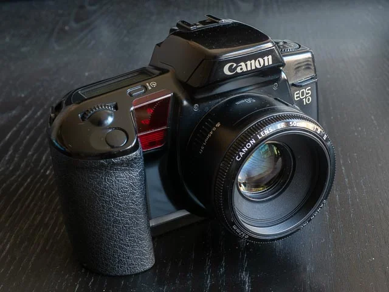
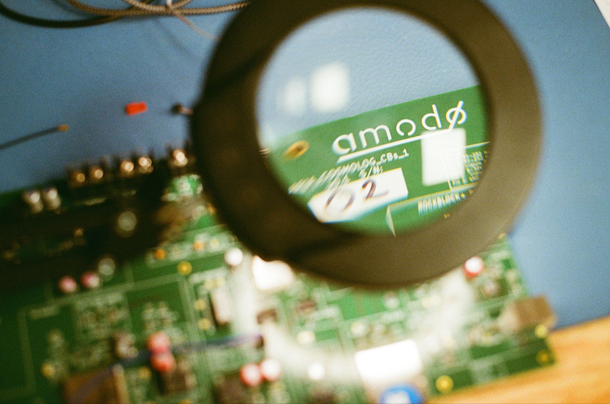
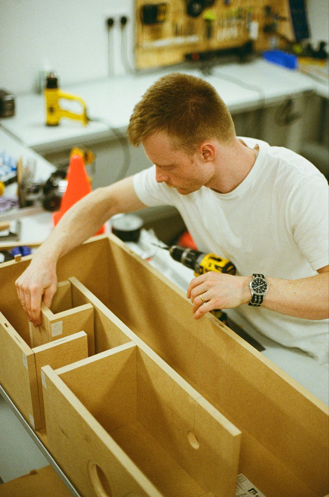
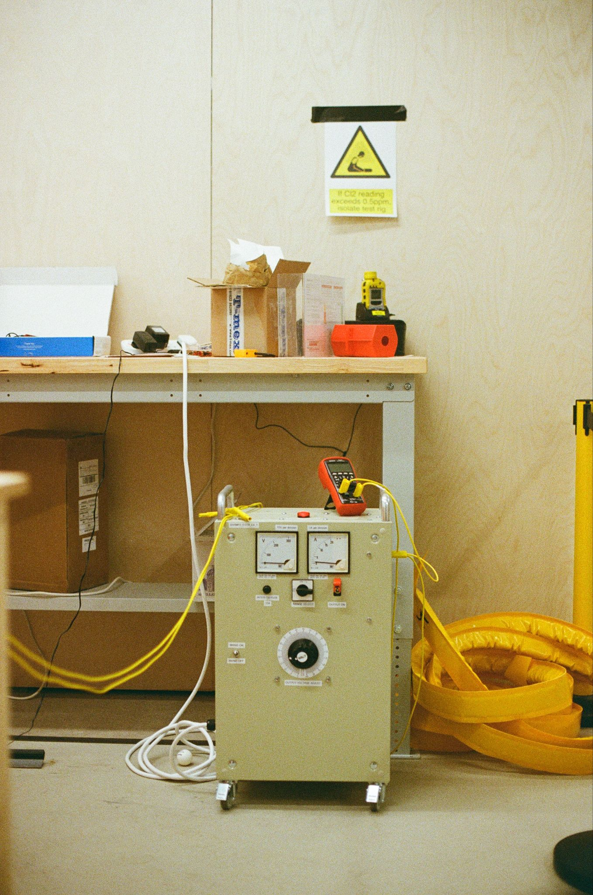
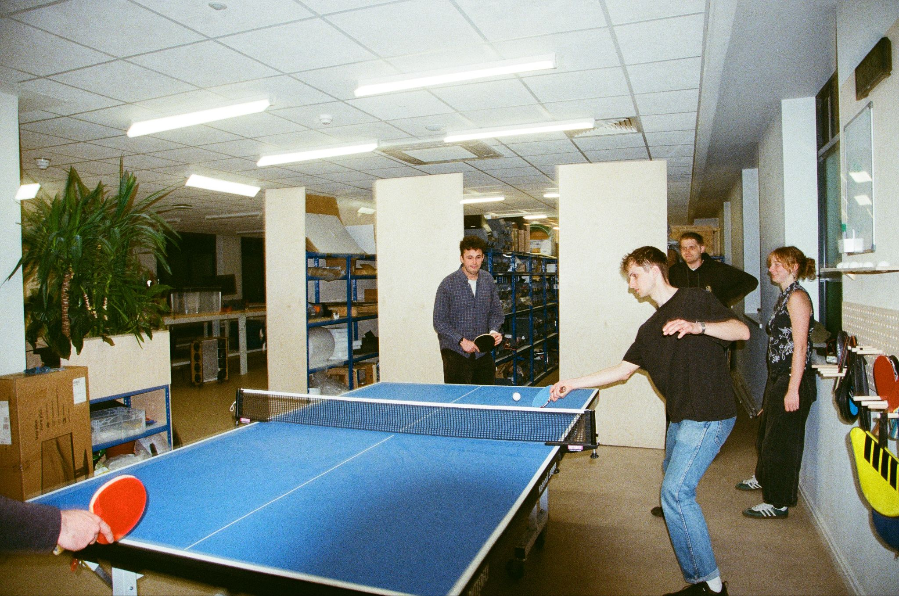
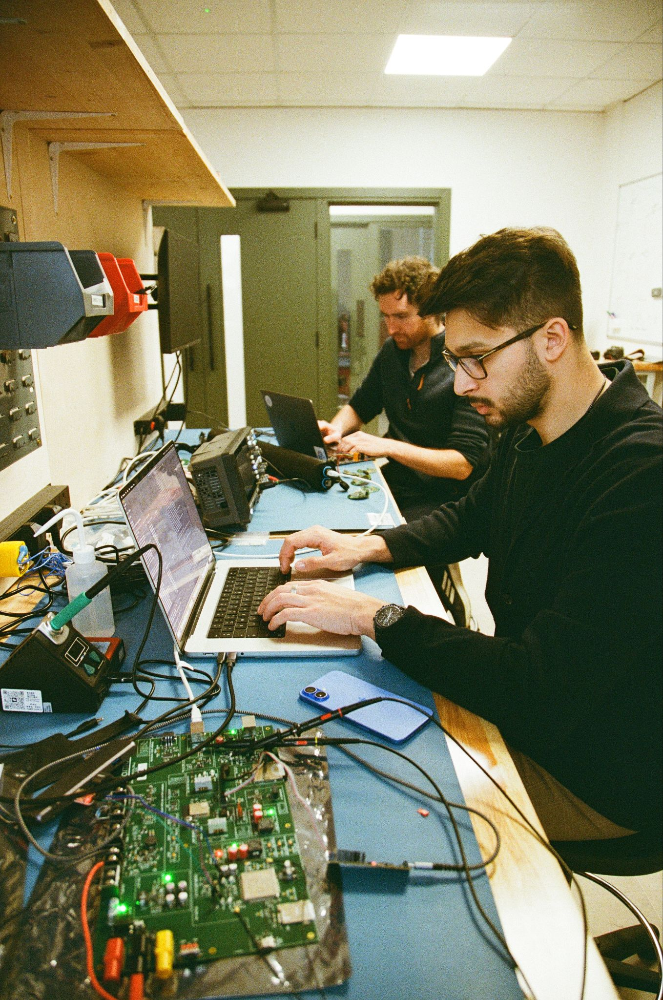
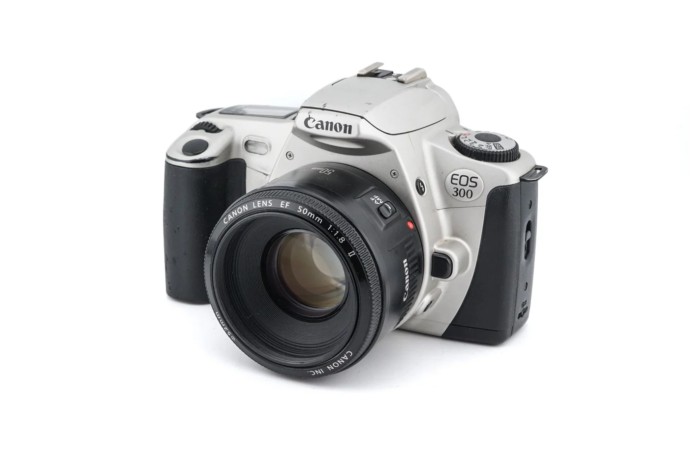
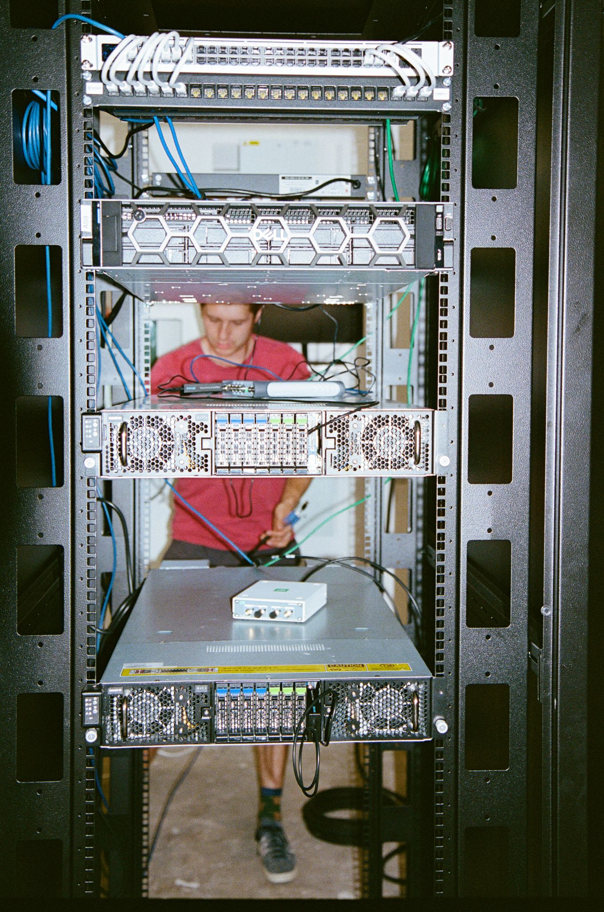
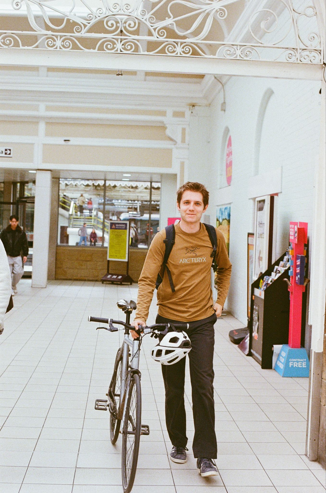
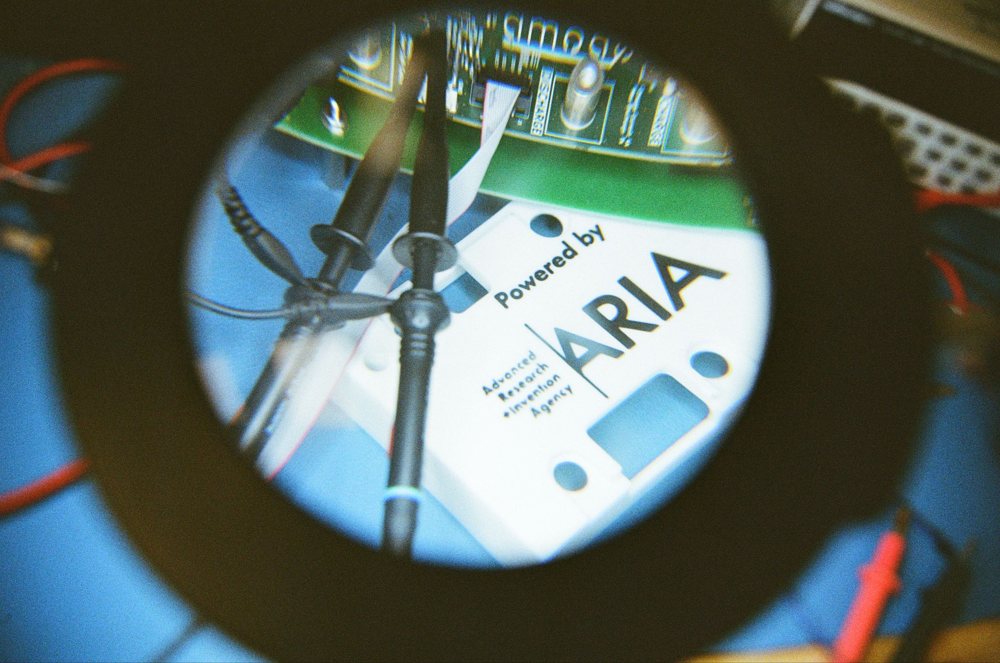

Aged 12, in a small room at the end of the English department corridor, I learnt to develop film. Lunchtime after lunchtime, alone in the dark, I fumbled film on top spools and filled canisters with chemicals that needed more ventilation than that stuffy room had. I learnt about contact sheets and experimented with developing prints where I only exposed part of the image. All of my photos were taken on my Dad’s Pentax MX, the camera he’d used 35 years earlier when he too developed his own photos.

This year, after more than a decade-long break, I started shooting on film again. The difference? I swapped out a Pentax MX for a Canon EOS 10 bought from a car boot sale when I was 14. Using this, now remarkably cheap, Canon camera taught me how most people should be shooting on film!

|  | Canon EOS 10 |
| --- | --- |
| Released | March 1990 |
| Produced until | c. 1992 |
| RRP at release (adjusted to 2026 GBP) | c. £1,040 |
| Going price on eBay | £20–£45 (body only) |

The first roll of film I shot on this ~£20 camera amazed me!

The colour and feel of the photos were so much better than I’d expected! I was immediately a convert to 1990s/2000s film cameras.

- **They fit my modern Canon EF lenses**, so I can actually shoot on high-quality glass. Lots of film photos I see are taken on old or cheap cameras, and they struggle due to poor lenses.
- **Modern autofocus**. Gone are the days of manual focus and a split prism; modern autofocus means photos are actually in focus. Film doesn’t have to mean a gamble on the subject being in focus.
- **Auto exposure**.

After using the Canon EOS 10, I decided I wanted to find something slightly smaller. Claude did a great job comparing options, and I opted for a Canon EOS 300, the frontier of *quality x price x size*. A Canon EOS 300 plus a nifty 50 (aka 50mm f1.8) is an amazing film setup for \<£100.

|  | Canon EOS 300 |
| --- | --- |
| Released | April 1999 |
| Produced until | September 2002 |
| RRP at release (adjusted to 2026 GBP) | c. £660 |
| Going price on eBay | £10–£25 (body only) |

A 90s or 00s film camera, compatible with modern lenses, should be the go-to for anyone shooting film. Pro or Instagrammer, get on eBay, Facebook Marketplace, or Vinted and get yourself one to play with!

Disclaimer: maybe it’ll come broken; it’s hard to tell from a £10 eBay listing whether a camera will work!

***

Lots more photos to come (and cameras to buy). Want to explore Canon film cameras? Claude made [this artifact](https://claude.ai/artifact/DKkcADxPhHZuA7x3B5MjWu).
