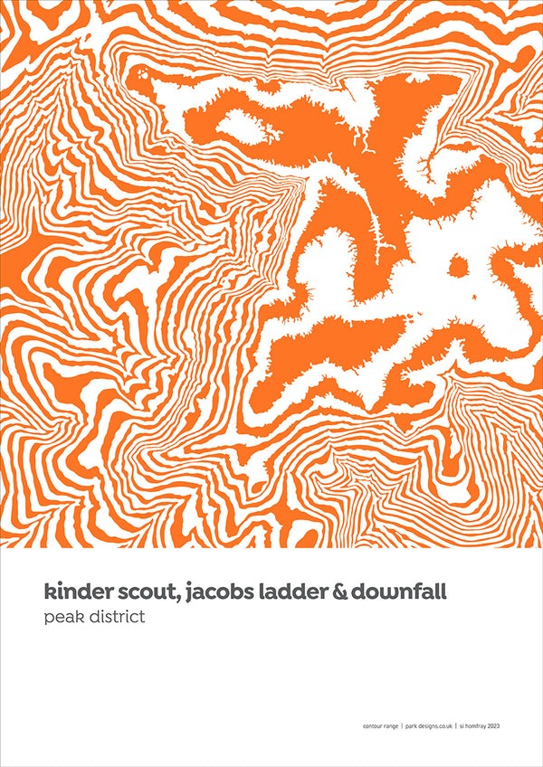
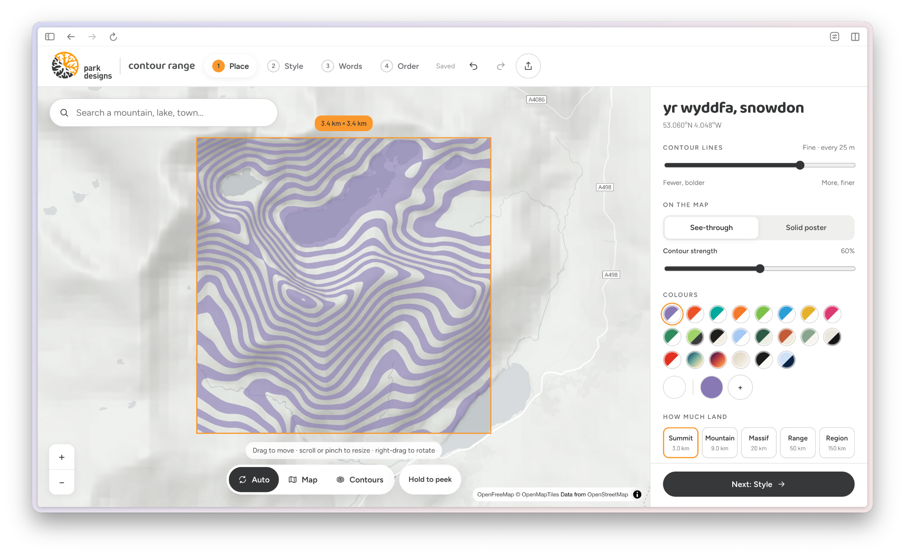
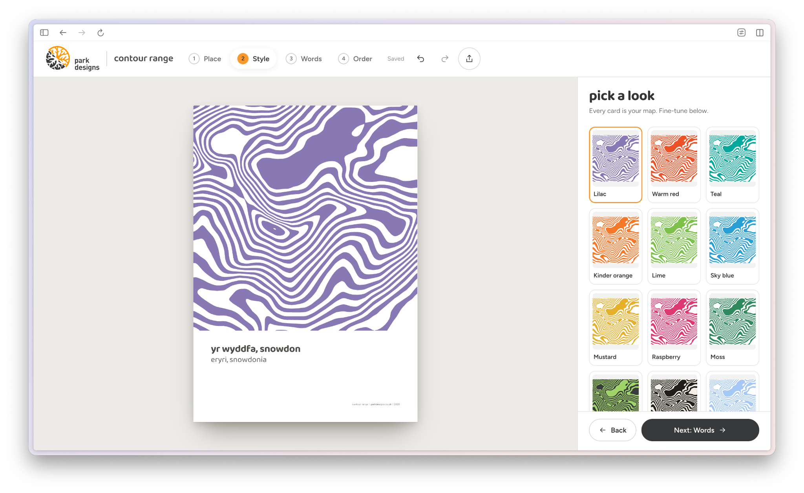
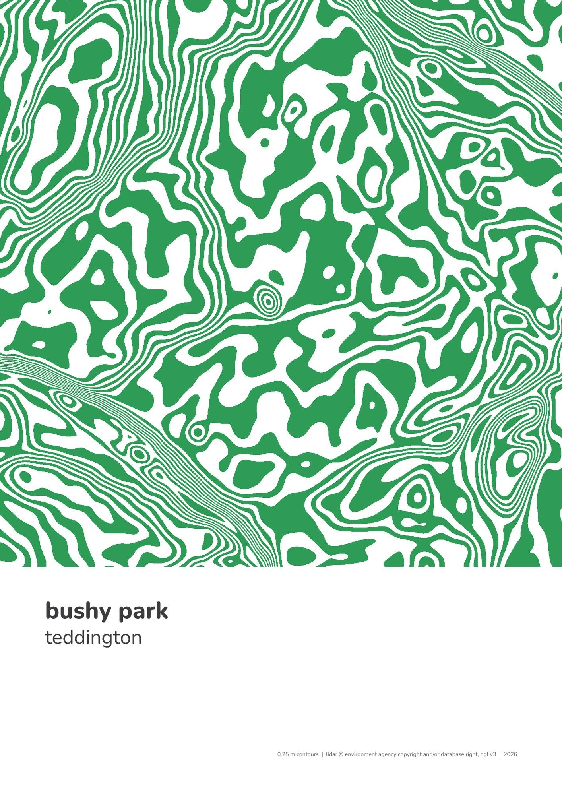
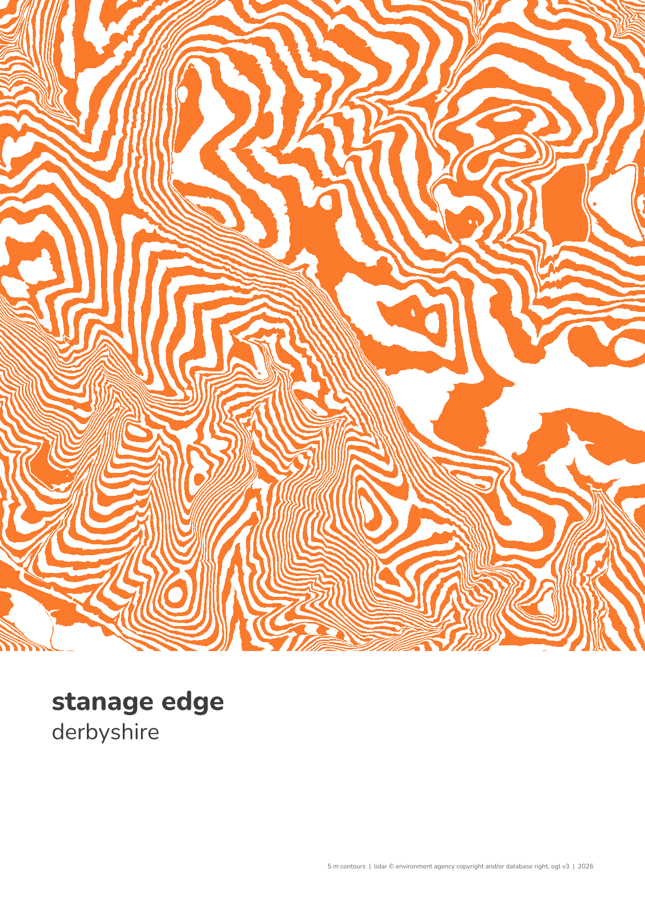
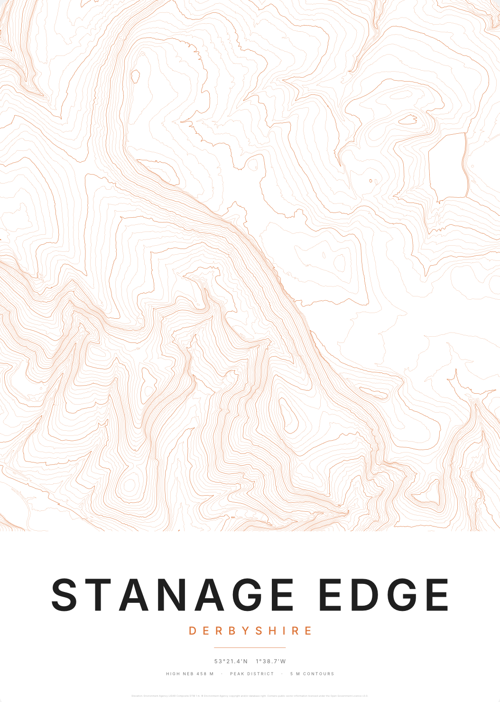
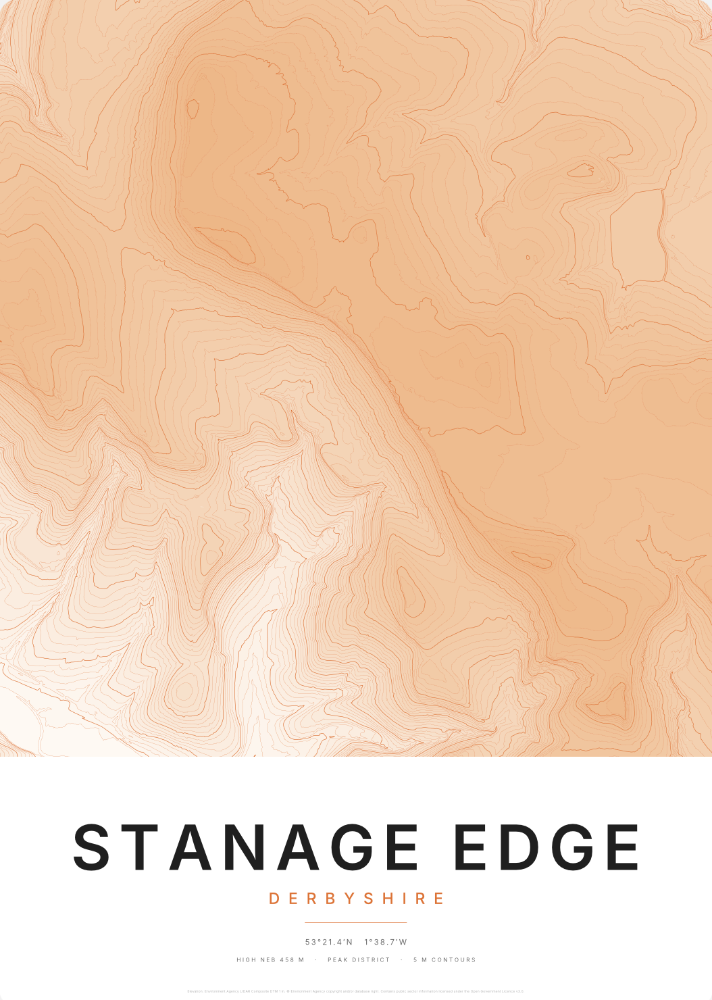
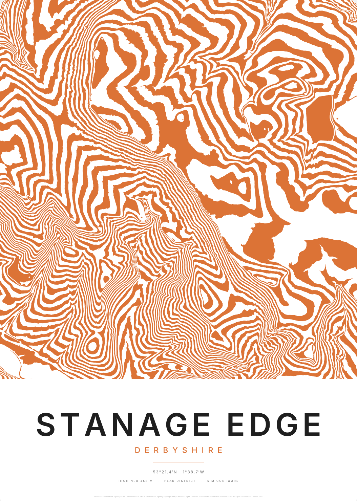
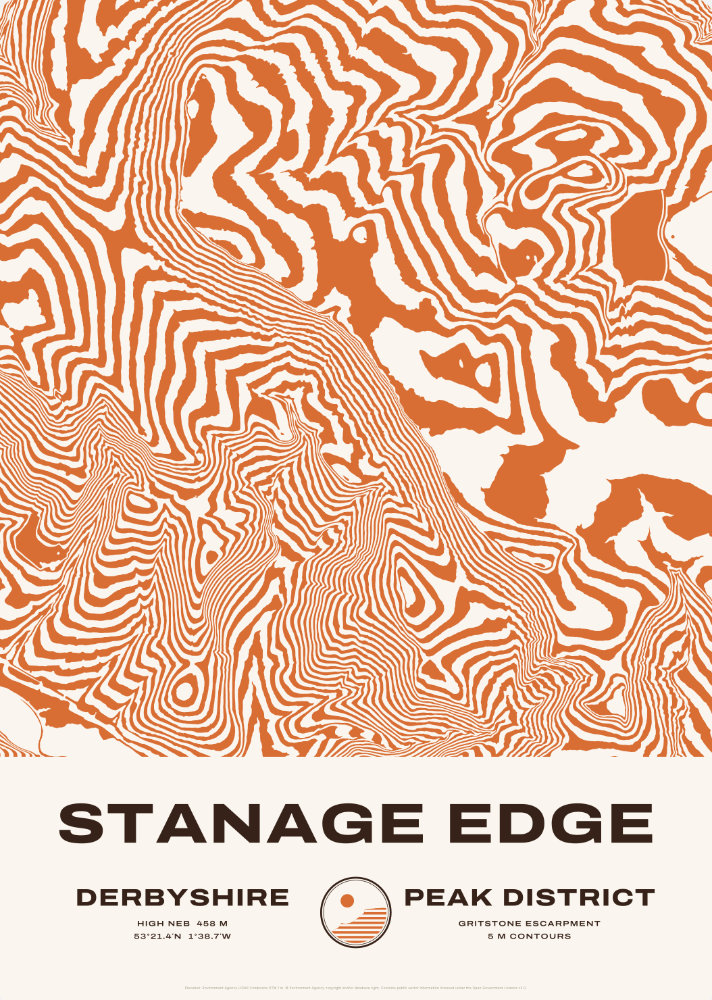
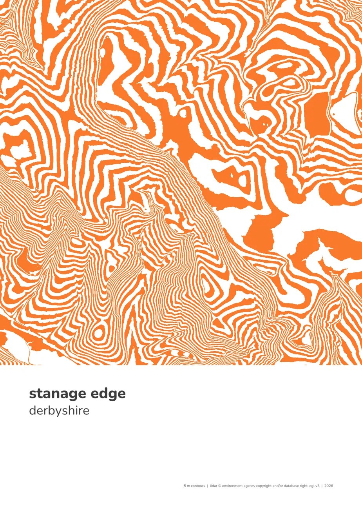

The AIs are so good at making tools for me. A page where the Amodo team can upload PCB photos and they're auto edited, a web app that tells me where to put different items in our stock system, or a page that tells me which coloured bin is next.

Last weekend I made a contour poster making tool. Inspired by Park Design, a Peak District artist, I made a tool that lets you create a contour map of any location you like. After a few prompts I had a fully deployed app for generating and selling these posters (Stripe checkout included).

*Original Park Design poster*

I really enjoyed making this tool, and sent it off to Si at Park Design who has now been using it. This is the first time I've made a tool and given it to a third party who actually loves it.

*The contour poster tool*

I’m really excited for Si to be using this and I really enjoyed shipping a piece of software. But I’m worried I’m not updating all the way, rather making software tools to solve problems seems like a transient era.

### Update all the way

But the AI makes cool tools era, is a transient era. Update all the way. As the AIs get smarter, and the UX the companies provide improves, you need not make the tool. Just ask the model.

This weekend, rather than ask Claude to make me a tool, I chose to ask it to make me a poster. I worry that people are too obsessed with using AIs to make new tools, when in fact the AIs will just make the end *thing*/solve the problem for the user. It won’t be **human asks AI to make tool, human uses tool**. But just **human asks AI to solve problem**.

*Two posters Claude made by just asking: Bushy Park and Stanage Edge*

My first round of requests to Claude were a bit meandering:

| Prompts | Results |
| --- | --- |
| I want you to make a contour poster of Stanage, and it should say Stanage Edge on it. I don't want you to look at any other repos apart from this MISC repo. And just come back once you've got a PDF where there are, it covers all of Stanage Edge. It has 5-meter contours, and it says Stanage Edge, Derbyshire, and the poster stuff, it like bleeds all the way to the edge. But then the bottom, maybe quarter, is white where the text is, and the contours are in orange. |  |
| Make them filled between the lines |  |
| Almost what I want you to do is to fill the alternating lines. So it goes orange, white, orange, white, orange, white, rather than it being the depth gradient thing. |  |
| Can you go and look at park designs online and look at their posters and see the stylizing and see how you can apply it to this? |  |
| Park design by Si in Sheffield |  |

I think we would get there straight away if, instead of providing the vague description of what I wanted, I'd just take a photo of a poster in a shop.

This is certainly different, and in so many ways disruptive. Many types of art and product design are now so so easily copyable (worrying!). But at the same time it's now possible to have artwork and products that exactly fit our taste or use case (cool!).

The biggest thing I want you to take away is not this question of copying, but rather this reflection on ways that tools may be defunct. The model itself can eat so much of the market. Rather than people building tools, I expect people to instead just simply ask their AIs to do things for them. Another example I noticed this weekend was designing a stock management tool.

I worked with Claude to create an artefact that had access to our Notion, was connected to a person’s Claude account, and could, if you took a photo of a *thing*, suggest which box it should go in in the workshop. This was the nub of a new tool, but I realised that ultimately the base model itself would probably just be doing all of this work for me. I wouldn’t need to make an Amodo stock tool, but rather just expect everyone to use the Claude or ChatGPT app itself to work out where something goes in our stock system.

Of course this doesn't totally retire all tools:

- It is more cost effective to use a tool each time, rather than reinventing the wheel. To make these posters Claude wrote tonnes of Python to extract UK lidar data; if I wanted to make lots of posters I'd want to reuse that.
- A tool or some common code/guidelines can ensure that results are the same across people. At a company you may want results to be produced in the same way each time.
- Some use cases require traceability. A tool with version control, user login, and an audit trail are needed in lots of cases.

There are reasons to update too strongly towards these three bullets; I won't go into them here.

***

### How Claude built the posters

Written by Claude

Claude built both posters in a cloud coding session as one Python script of about 250 lines, now in the contour-posters folder on a branch of my misc GitHub repo. Re-running it rebuilds every poster from scratch in about a minute.

- **Elevation data.** The Environment Agency publishes a free 1 m LIDAR terrain model of England (bare ground, with trees and buildings removed) under the Open Government Licence. The script downloads it in 1 km tiles, 49 for Stanage and 36 for Bushy Park at about 4 MB each, and stitches them into one height grid. As a check, High Neb comes out at 458 m.
- **Smoothing.** The raw data shows every boulder, wall and ditch, which breaks the bands up into noise, so the grid is blurred first: by 4 m for Stanage, which keeps the crag sharp, and by 40 m for Bushy Park.
- **Contour interval.** Stanage rises over 300 m, so 5 m contours give 65 bands. Bushy Park only falls about 10 m from Hampton Hill to the Thames, so it needs contours every 0.25 m to get a similar density (55 bands).
- **Bands.** The plotting library (matplotlib) fills the space between each pair of contours, alternating colour and white, so the contours are the edges between colours rather than drawn lines. Specks smaller than 200 square metres are merged into the band around them.
- **Layout.** Claude matched Park Design's Contour Range by measuring photos of the prints in Si's online shop: the map fills the top 71% of the page, the name is set in lowercase in a free rounded font (Nunito) on an 8% left margin, and a small credit line sits bottom right.
- **Output.** Each poster is saved as an A2 vector PDF, a 300 dpi PNG for printing, and a small PNG for documents like this one.

Before I pointed it at Si's work, it tried shading the bands by height and then a layout copied from 1930s US national park posters. Once it had photos of the real prints, the layout took two small tweaks.
